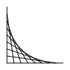
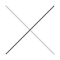

# DSBN-TS

[](https://github.com/yourtion/DSBN-TS/actions/workflows/ci.yml)

Design SVG By Numbers: a small, dependency-free TypeScript compiler for a
DBN-inspired drawing language. Compile drawings to standalone SVG using the
library or command line. Node.js 22.13 or later is required.

- **Small programs, real vector graphics:** variables, arithmetic, nested loops, and conditions.
- **Ready to use:** a TypeScript/JavaScript API and a CLI that exports standalone SVG files.
- **No runtime dependencies:** drawings compile without a browser, DOM, or canvas.

[Examples](#examples) · [Quick start](#quick-start) · [Library](#library) ·
[Command line](#command-line) · [Language](#language) · [Development](#development)

## Examples

Each preview below is the actual SVG compiled from the linked DBN source.
Click an image to open the vector output at full size.

<table>
  <tr>
    <td align="center" width="50%">
      <a href="example/fan.svg"></a><br>
      <strong>Line fan</strong><br>
      A descending loop and arithmetic.<br>
      <a href="example/fan.dbn">DBN source</a> · <a href="example/fan.svg">SVG output</a>
    </td>
    <td align="center" width="50%">
      <a href="example/grid.svg"></a><br>
      <strong>Nested grid</strong><br>
      Nested loops, variables, and questions.<br>
      <a href="example/grid.dbn">DBN source</a> · <a href="example/grid.svg">SVG output</a>
    </td>
  </tr>
  <tr>
    <td align="center" width="50%">
      <a href="example/shapes.svg"></a><br>
      <strong>Vector palette</strong><br>
      Six SVG shapes and CSS colors.<br>
      <a href="example/shapes.dbn">DBN source</a> · <a href="example/shapes.svg">SVG output</a>
    </td>
    <td align="center" width="50%">
      <a href="example/dots.svg"></a><br>
      <strong>Sample and reflect</strong><br>
      Read grayscale values and write dots.<br>
      <a href="example/dots.dbn">DBN source</a> · <a href="example/dots.svg">SVG output</a>
    </td>
  </tr>
</table>

For example, this entire program produces the **line fan** above:

```text
Paper 0
Pen 100
Repeat n 9 1 {
  Line 10 (n * 10) (100 - n * 10) 10
}
```

`Paper 0` makes a white canvas, `Pen 100` selects black, and `Repeat` draws
nine lines. Coordinates start at the **bottom left** of the 100 × 100 canvas.

## Quick start

**Requirements:** Node.js 22.13+ and npm. Install the published
[`dsbn` package](https://www.npmjs.com/package/dsbn) in your project:

```sh
npm install dsbn
```

Save the [line-fan program above](#examples) as `drawing.dbn`, then compile it
with the locally installed CLI:

```sh
npx dsbn drawing.dbn -o drawing.svg
```

Open `drawing.svg` in a browser. Edit the pen color or loop bounds, rerun the
command, and reopen the SVG to see the result.

For a one-off run without adding a project dependency or installing globally,
use the published version directly (npm may ask before downloading it):

```sh
npx dsbn@0.3.0 drawing.dbn -o drawing.svg
```

No repository checkout or build step is needed. For JavaScript/TypeScript
integration, continue with [Library](#library). To rebuild the examples and
open the offline gallery from source, see [Development](#development).

## Library

After `npm install dsbn`, import from `dsbn`, not from the repository's `dist`
directory. The package includes compiled JavaScript and TypeScript declarations.

### CommonJS

Save this as `drawing.cjs` and run `node drawing.cjs`:

```js
const { DSBN } = require('dsbn');
const fs = require('node:fs');

const compiler = new DSBN();
const svg = compiler.compile(`
  Paper 0
  Pen 100
  Repeat n 1 9 {
    Line 10 (n * 10) (100 - n * 10) 10
  }
`, { maxSteps: 100000 });
fs.writeFileSync('drawing.svg', svg);
```

### ES modules

Use the named export in a `.mjs` file (or a `.js` file in a project with
`"type": "module"`). Save this as `drawing.mjs` and run `node drawing.mjs`:

```js
import { DSBN } from 'dsbn';
import { writeFileSync } from 'node:fs';

const svg = new DSBN().compile('Paper 0 Pen 100 Line 0 0 100 100');
writeFileSync('drawing.svg', svg);
```

### TypeScript

Type declarations are bundled; no separate `@types` package is needed. In your
TypeScript project, use the same named import and optionally import the options
interface as a type:

```ts
import { DSBN, type ICompileOptions } from 'dsbn';

const options: ICompileOptions = { maxSteps: 100000 };
const svg: string = new DSBN().compile('Paper 0 Pen 100 Line 0 0 100 100', options);
console.log(svg);
```

Compile this with your project's TypeScript build before running the JavaScript.

The package entry point exports `DSBN`, `Lexer`, `Parser`, `Transformer`,
`Generator`, and their TypeScript interfaces. The individual stages remain
available as `lexer.lexer(source)`, `parser.parser(tokens)`,
`transformer.transformer(ast, options)`, and `generator.generator(svgAst)`.
These stages can be reused without consuming their inputs. Each compilation
starts with fresh variables and drawing state, including after an error.

`compile` returns an SVG string and throws on invalid input. `maxSteps` defaults
to 100,000 and must be a positive safe integer. Every executed statement, loop
iteration (even an empty body), and inspected point-sampling entry counts toward
the limit. Blocks, expressions, and SVG trees have a nesting limit of 100.

## Command line

After `npm install dsbn`, use `npx dsbn` from your project:

```sh
npx dsbn drawing.dbn -o drawing.svg
npx dsbn drawing.dbn > drawing.svg
printf 'Paper 0 Pen 100 Line 0 0 100 100' | npx dsbn -
npx dsbn drawing.dbn --max-steps 5000
npx dsbn --help
npx dsbn --version
```

The package exposes the `dsbn` executable, which can also be used directly in
npm scripts. For one-off use, replace `npx dsbn` with `npx dsbn@0.3.0`.
Omit the input path or use `-` to read stdin. Omit `-o` / `--output` to write
stdout. Errors go to stderr with exit status 1; compilation completes before an
output file is opened.

## Language

Commands and variable names are case-sensitive. Commands have fixed argument
counts, so multiple commands may share a line. Comments begin with `//` and run
to the end of the line. LF, CRLF, tabs, and adjacent braces are supported.
Expressions must fit on one line.

### Paper, pen, and variables

```text
Set background 0
Paper background
Pen 100
Set x 10
Set y (x * 2 + 5)
Line x y 90 90
```

- The canvas is 100 × 100, with `(0, 0)` at the bottom left and Y increasing up.
  SVG coordinates are converted automatically.
- Define `Paper` once, at the top level, before drawing. Define `Pen` before
  lines or SVG shapes. A dot assignment supplies its own color and needs no pen.
  Define the pen outside conditionals when later commands depend on it.
- Numeric colors use DBN grayscale: **0 is white, 100 is black**. Color values
  must be in `[0, 100]`. `Paper`, `Pen`, and dot assignments also accept quoted
  CSS named colors, hex colors, and numeric `rgb()`, `rgba()`, `hsl()`, `hsla()` strings.
  CSS variables, resource URLs, and arbitrary CSS expressions are not supported.
- `Set name value` evaluates and stores a value immediately. Variables can hold
  numbers or color/path strings. Blocks share variables; an undefined variable
  is an error. Names contain letters, digits, and underscores, cannot start
  with a digit, and cannot be command names.
- Coordinates and variables can be outside `[0, 100]`; SVG clips drawing at the
  canvas edge. All numeric results must be finite.

### Blocks, arithmetic, and loops

```text
Paper 0
Pen 100
Set step 10
Repeat column 1 4 {
  Repeat row 4 1 {
    {
      Circle (column * step) (row * step) (step / 3)
    }
  }
}
```

Use parentheses around calculations: `(a + b * 2)`. `*` and `/` take precedence
over `+` and `-`; operators of equal precedence associate left to right. Unary
`+` / `-`, nested parentheses, decimals, and scientific notation are supported.
Division by zero and non-finite results are errors. Arithmetic is numeric only.

`Repeat counter start end { ... }` includes **both endpoints**, counting up or
down by 1. Bounds are evaluated once and must be safe integers. The counter is
local to the loop: its previous value is restored afterward, or removed if it
was previously undefined. Nested loops can reuse a counter name. Other variable
and pen changes persist. Standalone `{ ... }` blocks execute once.

### Questions

```text
Same? a b { Line 0 0 100 100 }
NotSame? a b { Line 0 100 100 0 }
Smaller? a b { Circle 50 50 10 }
NotSmaller? a b { Rect 40 40 20 20 }
```

Questions compare numbers: `=`, `!=`, `<`, and `>=`, respectively. `Same ?` (with
a space) is also accepted, as are the other spaced question marks. Bodies can
contain any nested blocks, loops, and questions. A false body is not evaluated.

### Points

```text
Paper 0
Set [10, 20] 75
Set shade [10 20]
Pen shade
Line 0 0 100 100
```

`Set [x y] color` draws a 1 × 1 square centered on an integer coordinate.
`[x, y]` and `[x y]` are equivalent. Point coordinates must lie in `[0, 100]`.
Reading `[x y]` samples the most recent **DBN** `Paper`, `Line`, or dot assignment
at that coordinate. Lines use a one-unit stroke with round caps. Reads require
a numeric grayscale color; a sampled CSS color throws an error.

SVG extensions below are vector-only and do not modify the DBN point-sampling
history. This keeps DBN reads deterministic without a DOM or raster renderer.

### SVG extensions

| Command | Arguments | Result |
| --- | --- | --- |
| `Rect` | `x y width height` | Filled rectangle; `(x, y)` is the lower left corner |
| `Circle` | `x y radius` | Filled circle centered at `(x, y)` |
| `Ellipse` | `x y radiusX radiusY` | Filled ellipse centered at `(x, y)` |
| `Polyline` | `[x y] [x y] ...` | Open stroked line with at least 2 points |
| `Polygon` | `[x y] [x y] [x y] ...` | Filled polygon with at least 3 points |
| `Path` | `"M 10 10 L 90 10 L 50 90 Z"` | Filled SVG path |

Shapes use the current pen color, and dimensions/radii must be non-negative.
Path supports absolute and relative `M L H V C S Q T A Z` command groups;
its first command must be `M` / `m`. Numeric groups and arc flags are validated.
Path also uses DBN's upward Y axis through an SVG transform. Strings use JSON
double-quote and escape rules. Generated attribute values are XML escaped.

## Development

To work on the compiler or rebuild the example gallery, start from a checkout:

```sh
git clone https://github.com/yourtion/DSBN-TS.git
cd DSBN-TS
npm ci
npm run demo
node dist/cli.js example/fan.dbn -o drawing.svg
```

Open `example/index.html` from your local checkout for the complete offline
gallery; the [gallery source](example/index.html) is also in the repository.
`npm run demo` compiles the project and rebuilds all four checked-in example SVGs
from their `.dbn` sources. After compiling, use `node dist/cli.js` to test the
checkout's CLI instead of the published package.

```sh
npm test            # Compile and run all unit, integration, CLI, and demo tests
npm run lint        # ESLint (does not rewrite files)
npm run test-cov    # Coverage summary, coverage/index.html, and coverage/lcov.info
npm run demo        # Rebuild the four SVG examples
npm run check       # Lint, tests, and demos
npm pack --dry-run  # Inspect the package; prepack builds distributable files
```

GitHub Actions runs lint, coverage, demo reproducibility, and packaging checks
on Node.js 22 and 24. There are no production dependencies.

This is a DBN-inspired SVG language, not a complete implementation of the
original DBN runtime: custom procedures, animation, input connectors, and
rasterization of SVG extensions are outside its scope.

## License

[MIT](LICENSE)
